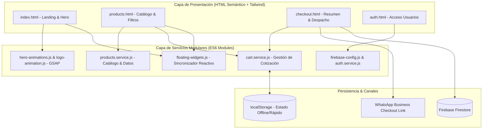

<p align="center">
  
  
  
  
  
  
</p>

<h1 align="center">
  🛡️ Shaddai Industrial — E-Commerce & Catálogo de Indumentaria Industrial y EPPs
</h1>

<p align="center">
  <strong>Plataforma web de comercio y cotizaciones corporativas para ropa de trabajo pesado, minería, construcción y equipos de protección personal.</strong>
</p>

<p align="center">
  Construido con una arquitectura orientada a servicios en <strong>JavaScript puro (ES6+ Vanilla)</strong> sin sobrecarga de frameworks, logrando tiempos de carga casi instantáneos, sincronización reactiva de cotizaciones y animaciones cinemáticas con <strong>GSAP</strong>.
</p>

---

## 📑 Tabla de Contenidos
- [📌 Descripción del Negocio](#-descripción-del-negocio)
- [✨ Características Principales](#-características-principales)
- [🏛️ Arquitectura Modular en Vanilla JS](#️-arquitectura-modular-en-vanilla-js)
- [🛠️ Stack Tecnológico](#️-stack-tecnológico)
- [📦 Estructura del Proyecto](#-estructura-del-proyecto)
- [🚀 Instalación y Desarrollo](#-instalación-y-desarrollo)
- [📄 Licencia](#-licencia)

---

## 📌 Descripción del Negocio

**Shaddai Industrial** atiende a contratistas, empresas mineras, talleres y plantas industriales que requieren indumentaria de alta resistencia (mamelucos térmicos, pantalones cargo drill, casacas impermeables, chalecos geólogo con cintas reflectivas 3M y calzado normado).

El sistema permite a los encargados de logística y compras:
1. Explorar el catálogo técnico filtrando por sector y normativa.
2. Armar listas de cotización con cálculo en tiempo real.
3. Despachar la solicitud formal a ventas mediante **WhatsApp Business** o guardarla en **Firebase Firestore**.

---

## ✨ Características Principales

### 1. ⚡ Arquitectura Service-Oriented en Vanilla JS
- Separación limpia de responsabilidades mediante módulos ES6 nativos (`import`/`export`).
- Sin la sobrecarga de un framework SPA, garantizando un índice de rendimiento de 99+ en Google PageSpeed.

### 2. 🛒 Carrito de Cotización Reactivo & Persistente
- Sincronización en tiempo real entre páginas (`index.html`, `products.html`, `checkout.html`) vía `cart.service.js` y `localStorage`.
- Widget flotante interactivo con indicador de cantidad y acceso rápido.

### 3. 🔍 Catálogo Multifiltro
- Estructura jerárquica: *Ropas Industriales*, *Calzado de Seguridad*, *EPPs*, *Uniformes Institucionales*.
- Búsqueda en vivo y filtrado reactivo sin recargar la página.

### 4. 🎬 Animaciones Cinemáticas con GSAP
- Secuencias de revelación en el Hero, animaciones del logotipo corporativo y efectos dinámicos con `ScrollTrigger`.

### 5. 🔐 Integración Firebase
- Base preparada para autenticación de clientes corporativos y persistencia NoSQL de órdenes de cotización en Cloud Firestore.

---

## 🏛️ Arquitectura Modular en Vanilla JS



---

## 🛠️ Stack Tecnológico

| Herramienta | Rol / Propósito |
|---|---|
| **Vite 8.0** | Empaquetador ultrarrápido y servidor de desarrollo HMR |
| **JavaScript ES6+** | Lógica de negocio modular desacoplada en servicios |
| **Tailwind CSS v3.4** | Sistema de diseño utilitario para indumentaria industrial |
| **GSAP & ScrollTrigger** | Motor de animaciones de alto rendimiento para el Hero y Logo |
| **Firebase (v10)** | Authentication y Cloud Firestore para gestión de pedidos |

---

## 📦 Estructura del Proyecto

```plaintext
Shaddai-Industrial/
├── frontend/
│   ├── css/
│   │   ├── input.css          # Directivas de Tailwind CSS
│   │   └── style.css          # CSS compilado
│   ├── img/                   # Fotografías de productos y talleres
│   ├── js/
│   │   ├── auth.service.js    # Lógica de inicio de sesión con Firebase
│   │   ├── cart.service.js    # Carrito reactivo en memoria y localStorage
│   │   ├── catalog.js         # Filtrado interactivo y renderizado de tarjetas
│   │   ├── checkout.js        # Generación de orden y enlace a WhatsApp
│   │   ├── firebase-config.js # Inicialización del SDK de Firebase
│   │   ├── floating-widgets.js# Notificador flotante de cotización
│   │   ├── hero-animations.js # Animaciones de scroll con GSAP
│   │   └── products.service.js# Definición de productos y jerarquía
│   ├── index.html             # Landing page principal
│   ├── products.html          # Vista de catálogo completo
│   ├── checkout.html          # Vista de revisión y envío de cotización
│   └── auth.html              # Vista de autenticación
├── package.json               # Dependencias y scripts de Vite/Tailwind
├── tailwind.config.js         # Paleta de colores industriales (Navy, Steel, Gold)
└── vite.config.js             # Configuración de entrada multipágina
```

---

## 🚀 Instalación y Desarrollo

### Prerrequisitos
- **Node.js** v18 o superior
- **npm**

### Pasos

1. **Clonar e ingresar a la carpeta:**
   ```bash
   git clone <URL_DEL_REPOSITORIO>
   cd Shaddai-Industrial
   ```

2. **Instalar dependencias:**
   ```bash
   npm install
   ```

3. **Ejecutar en modo desarrollo:**
   ```bash
   npm run dev
   ```
   Abre la URL proporcionada por Vite (habitualmente `http://localhost:5173/frontend/index.html`).

4. **Compilar estilos CSS:**
   ```bash
   npm run build:css
   ```

5. **Construir para producción:**
   ```bash
   npm run build
   ```

---

## 📄 Licencia

Este proyecto está bajo la Licencia [MIT](LICENSE). Desarrollado para *Shaddai Industrial*.
